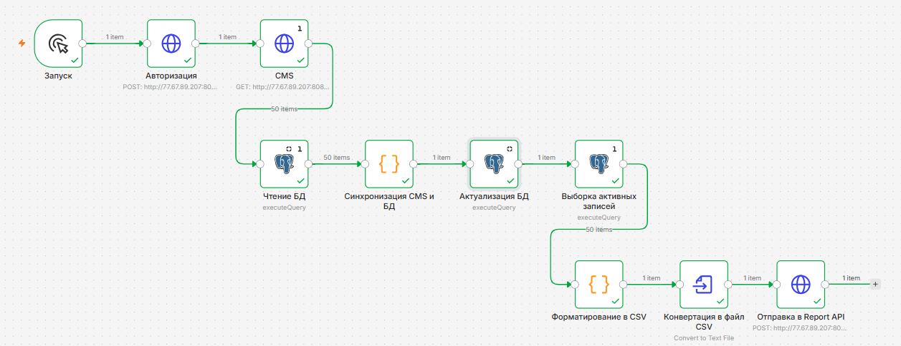
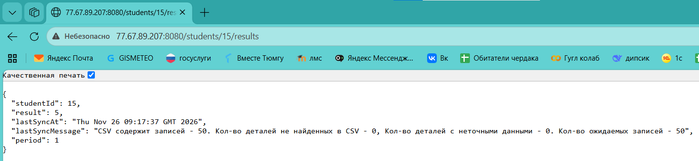

# Интеграция систем, разработка интеграционных сервисов

Реализовано на базе n8n и PostgreSQL.

## Архитектура Workflow

1. **Запуск** — ручной старт сценария.
2. **Авторизация** — отправляет логин и пароль на сервер, чтобы получить специальный ключ доступа для дальнейшей работы.
3. **CMS** — загружает каталог записей с внешнего сервера по частям (по 10 записей за один раз).
4. **Чтение БД** — извлекает текущие данные из таблицы в локальной базе данных PostgreSQL.
5. **Синхронизация CMS и БД** — сравнивает данные из внешнего каталога и локальной базы. Определяет, какие записи нужно добавить, какие изменились, а какие исчезли.
6. **Актуализация БД** — выполняет обновление базы данных на основе результатов сравнения: сохраняет новые записи, обновляет измененные данные и помечает отсутствующие в CMS записи флагом is_deleted = TRUE.
7. **Выборка активных записей** — достает из базы только те детали, которые не были помечены как удаленные.
8. **Форматирование в CSV** — собирает данные в единую текстовую таблицу, разделяя значения точкой с запятой без заголовков.
9. **Конвертация в файл CSV** — превращает текст в готовый файл в кодировке UTF-8.
10. **Отправка в Report API** — отправляет готовый файл на сервер для формирования отчета.

## Workflow

## Результат

